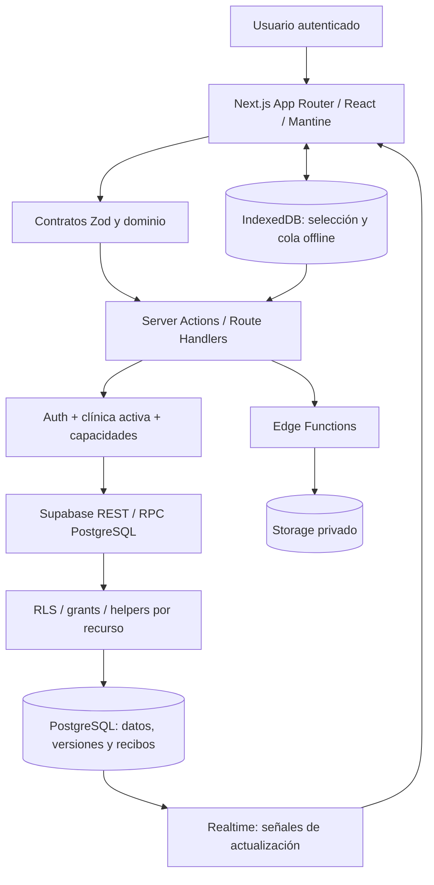
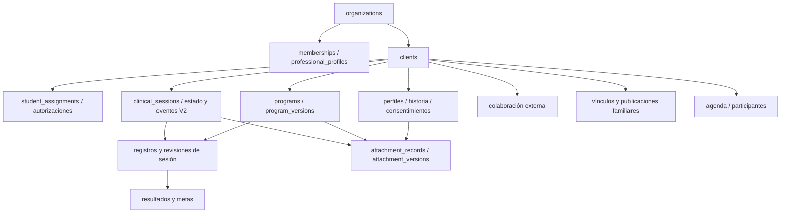
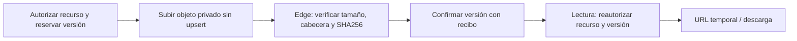
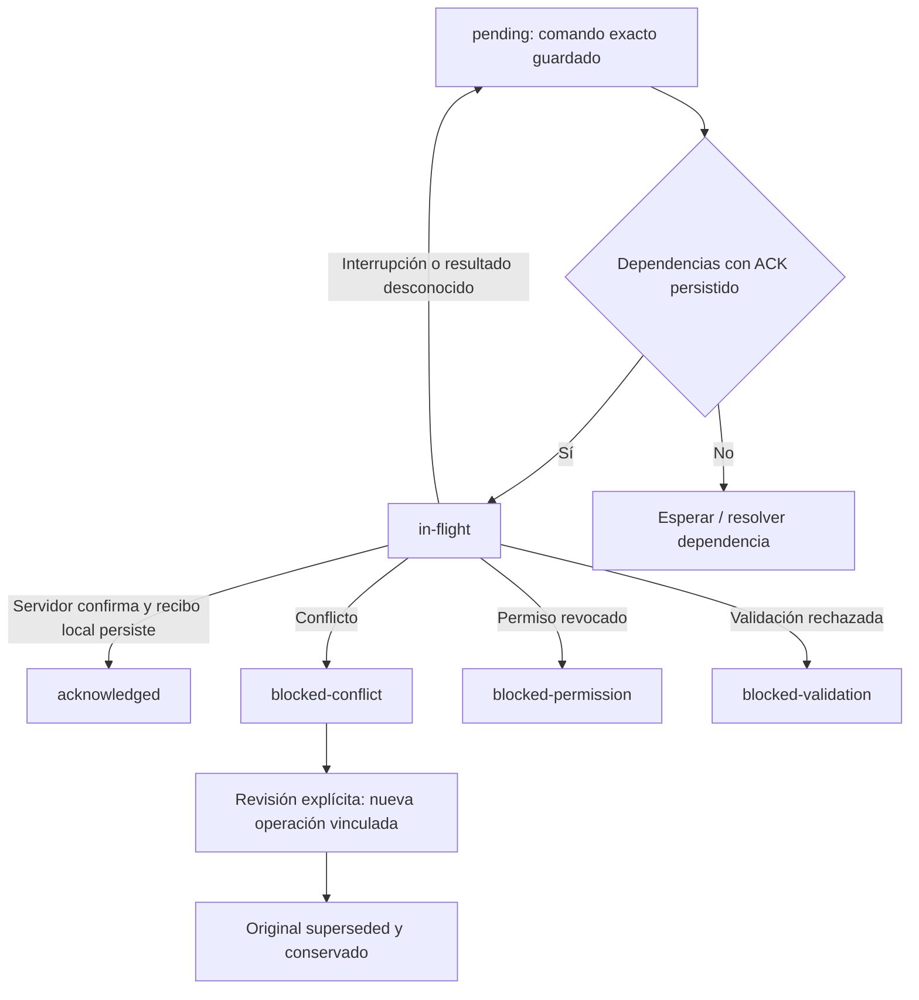

# ABA: guía técnica para desarrollo e IA

Fecha de elaboración: 2026-10-20. Proyecto autorizado: `C:/Users/Moonlabpc/Desktop/ABA/ABA_PROTOTIPO`.

## 1. Propósito y alcance

ABA es una aplicación clínica multiclínica para administrar fichas, equipo, programas de intervención, sesiones y mediciones, resultados, colaboración, publicaciones para familiares, agenda y documentos. Esta guía explica la implementación y sus contratos; no constituye una aceptación del producto ni una nueva ejecución de QA.

Se elaboró mediante lectura estática del repositorio. El estado de validación procede del checkpoint del 19 de octubre de 2026. No se consultaron datos clínicos, secretos ni una base remota para elaborar este paquete.

El código conserva componentes históricos V1 junto con contratos V2. La existencia de una tabla, pantalla o endpoint no demuestra que esté incluido en el cierre, validado o desplegado. Chat, adjuntos de chat y R6 están diferidos.

## 2. Lectura recomendada y fuentes de autoridad

1. Leer esta guía para entender arquitectura y recorridos.
2. Consultar [inventario estructurado](INVENTARIO_TECNICO_ABA.json) para localizar tablas, columnas, relaciones tipadas, funciones y rutas.
3. Contrastar cada cambio con contratos de dominio, Server Actions y migraciones correspondientes.
4. Consultar [checklist pendiente](../docs/qa/CHECKLIST_PENDIENTE_CIERRE_R5_20261010.md), [matriz UX/contrato/persistencia](../docs/MATRIZ_UX_CONTRATO_PERSISTENCIA_ABA_LOCAL.md) y [checkpoint](../docs/status-map/ABA_LOCAL.json) antes de declarar un flujo cerrado.

Autoridad por asunto: SQL para esquema, grants y RLS; contratos y adaptadores para comportamiento ejecutado; evidencia QA para validación; decisión humana para aceptación. Los tipos generados ayudan a navegar, pero no reemplazan SQL ni validación runtime. README y handoffs antiguos contienen estados históricos: no extrapolar sus pendientes al candidato actual.

## 3. Arquitectura general



Frontend y backend web pertenecen al mismo proyecto Next.js. No hay que buscar un servidor Express independiente. Las Server Actions gestionan operaciones de negocio y llaman funciones SQL; los Route Handlers atienden, entre otros, callbacks y descargas. Supabase aporta Auth, PostgreSQL/PostgREST, Storage, Realtime y Edge Functions.

El diagrama es conceptual: las suscripciones Realtime avisan de cambios; la lectura autorizada vuelve a determinar qué puede ver el usuario. No sustituyen los controles de acceso.

## 4. Herramientas y dependencias

Versiones declaradas en [package.json](../package.json), no una auditoría de todas las versiones instaladas. El lockfile determina las resoluciones exactas.

| Capa | Herramientas |
|---|---|
| Runtime | Node 22.x; runtime local disponible 22.23.2; npm 10.9.8 |
| Web | Next.js ^16.1.6, React ^19.2.3, TypeScript ~5.9.3 |
| Interfaz | Mantine ^7.15.2, iconos Lucide, notificaciones y componentes auxiliares |
| Contratos | Zod ^4.3.6 |
| Backend | Supabase JS ^2.95.3, SSR ^0.8.0; CLI 2.117.0 |
| Resultados | Recharts ^3.7.0, jsPDF 4.2.1, dayjs |
| QA | Playwright 1.63.0, Vitest ^4.1.11, PGlite 0.5.8, ESLint 9, colecciones Postman/Newman |
| Operación | Docker para entorno local; configuración de despliegue Next + Caddy preparada |

El flujo local vigente utiliza webpack. No sustituirlo automáticamente por Turbopack sin comprobar las restricciones del montaje y del entorno.

## 5. Mapa del código

| Directorio | Responsabilidad |
|---|---|
| `app/` | Rutas, layouts, páginas y handlers HTTP |
| `src/views/` | Composición de pantallas |
| `src/features/` | Funcionalidades de fichas, programas, equipo, capturas y resultados |
| `src/domain/` | Contratos, validaciones, estados, comandos y reglas de dominio |
| `src/modules/` | Adaptadores funcionales, Server Actions, DTO y paneles |
| `src/lib/supabase/` | Clientes browser/servidor, sesión y tipos generados |
| `supabase/migrations/` | Evolución SQL ordenada; fuente del esquema y de sus permisos |
| `supabase/functions/` | Invitaciones, reenvíos y verificación de adjuntos |
| `tests/`, `scripts/local/` | Pruebas y herramientas de operación/QA |
| `docs/qa/`, `docs/runbooks/` | Evidencia y procedimientos |
| `deploy/` | Preparación de despliegue; no acredita publicación |

`src/modules/clinical` conserva lógica histórica utilizada. No eliminarlo por parecer duplicado sin analizar sus consumidores. `.aba.local/` puede contener estado privado de ejecución, fixtures y respaldo; no se debe compartir íntegramente ni tratarlo como documentación pública. `.next/`, `node_modules/` y `.runtime.local/` son artefactos de ejecución.

## 6. Identidad, perfiles y autorización

Fuentes principales: [tipos de identidad](../src/features/team/identity.types.ts), [identidad en servidor](../src/features/team/identity.server.ts), [capacidades de ficha](../src/lib/authorization/student.ts).

La identidad se recupera con `auth.getUser()` y `aba_identity_context`. Un usuario puede tener varios contextos autorizados. La cookie HttpOnly `aba-clinic` selecciona una clínica de `identity.choices`; no concede acceso por sí sola. Las acciones comprueban que el contexto actual coincide con el esperado antes de escribir.

Nombre, profesión, título, teléfono y avatar son datos de perfil. Modificarlos no cambia las capacidades. La membresía profesional usa `admin`, `supervisor` y `therapist`; el técnico de la interfaz corresponde a `therapist`. Los contextos incluyen además `external` y `family`.

| Perfil | Alcance efectivo y condiciones |
|---|---|
| Administrador de clínica | Equipo, membresías y operación de su clínica; requiere membresía activa. No equivale a administrador global de otras clínicas. |
| Supervisor | Operación clínica y programas en fichas asignadas; asignación, membresía y vigencia activas. Determinadas decisiones de autorización requieren supervisor principal. |
| Técnico / therapist | Lectura autorizada, sesión, captura, envío y resultados en fichas asignadas. No inferir permiso de administración o diseño por poder registrar datos. |
| Externo | Acceso explícito por ficha y nivel concedido. Una invitación pendiente no concede acceso. |
| Familiar | Vínculos y publicaciones dirigidas a destinatarios; no lectura general de la ficha clínica. |
| Sin sesión | No obtiene acceso a recursos privados; las rutas públicas y de autenticación no constituyen acceso clínico. |

Los niveles externos son `full-read`, `program-results` y `clinical-edit`. `program-results` no incluye `student.view`: ver resultados de un programa no permite leer notas clínicas generales. La revocación y la vigencia se revisan en servidor. `coordinator` aparece en asignaciones históricas y pruebas de autorización; no es un cuarto rol del enum de membresía profesional.

La función `get_student_capabilities` consulta las capacidades efectivas del usuario actual. `private.has_student_capability` compone permisos internos y colaboración externa. La UI oculta o deshabilita controles, pero Auth, RPC, grants y RLS son la barrera efectiva.

Para probar perfiles, usar cuentas, membresías, asignaciones y concesiones coherentes. Cambiar un campo de perfil o `user_metadata` no reproduce un usuario autorizado completo. No sustituir los recorridos de creación de cuenta por cambios manuales indiscriminados en la DB.

## 7. Recorridos funcionales

```mermaid
flowchart LR
  A[Clínica: acceso y equipo] --> B[Invitar / activar cuentas]
  B --> C[Crear ficha y asignar profesionales]
  C --> D[Supervisor: historia y diseño de programa]
  D --> E[Publicar versión y gestionar ciclo]
  E --> F[Técnico: abrir sesión y seleccionar programa]
  F --> G[Capturar, pausar, revisar y enviar]
  G --> H[Resultados, gráficas y exportación]
  H --> I[Supervisor: revisar evolución]
  I --> J[Colaboración o publicación familiar autorizada]
```



Este es un recorrido de negocio, no una afirmación de que el ensayo humano final se haya ejecutado. Las tres jornadas humanas de clínica, supervisor y técnico, incluyendo creación de cuentas, siguen reservadas para el final.

### Ficha clínica

Las fichas reúnen identificación clínica, perfil, contactos, familiares, hermanos, historia, consentimientos y documentos. `clinical_id` es un identificador de negocio distinto del nombre o documento personal. Historiales y consentimientos mantienen versiones/eventos; no interpretar una retirada o archivo lógico como destrucción física de toda la historia.

### Programas y sesiones

Los programas incluyen adquisición y conducta, borradores y versiones publicadas. Una versión publicada debe conservar su identidad; los cambios posteriores se representan mediante versiones sucesoras. El ciclo contempla borrador, activo, pausado, logrado y discontinuado según los contratos.

Una sesión conserva el programa y la versión seleccionados. Sus eventos contemplan inicio, pausa, reanudación, finalización y cancelación. Las cinco dimensiones de medición son porcentaje, frecuencia, intervalo, duración y latencia. Los datos enviados, sus revisiones y los descartes deben conservar trazabilidad; no reconstruir eventos V2 ficticios a partir de un agregado V1.

### Resultados

Las gráficas, metas, CSV y PDF dependen de registros autorizados y de la semántica de medición. Conciliar valor, filtros, programa, versión y dimensiones entre UI y exportaciones. La compatibilidad de resultados V1 no demuestra por sí sola cobertura de todos los escenarios históricos de diseño V1.

### Colaboración, familia y agenda

La colaboración concede capacidades por ficha mediante invitaciones, aceptación, acceso activo y revocación. Familia recibe publicaciones explícitas y recursos seleccionados. La agenda modela series, citas, participantes y recordatorios; comprobar zonas horarias y participantes al modificarla.

Comercial y soporte tienen planes, suscripciones, documentos y tickets. Su presencia no acredita una integración de cobros o un proveedor de pagos externo.

## 8. Cómo se guarda una operación

Fuente guía: [adaptador de programas y sesiones](../src/modules/program-session/program-session.server.ts), [resultado de comando](../src/domain/commands/result.ts).

```mermaid
sequenceDiagram
  participant U as UI
  participant A as Server Action
  participant P as RPC / PostgreSQL
  U->>A: Payload validado + operación + clave + versión esperada
  A->>A: Sesión, clínica y contrato
  A->>P: Comando con identidad del actor
  P->>P: Autorizar recurso y comprobar idempotencia / versión
  alt Aceptado
    P->>P: Mutación y recibo en una transacción
    P-->>A: acknowledged + recibo + versión
    A->>A: Correlacionar operación, clave y recurso
    A-->>U: ACK; refrescar vista
  else Conflicto o rechazo
    P-->>A: conflict / rejected
    A-->>U: Conservar trabajo y explicar resolución
  end
```

Los comandos V2 utilizan `operationId`, `idempotencyKey`, recurso y versión esperada. El servidor identifica el payload y registra el resultado durable. Un reintento exacto devuelve el recibo original; reutilizar una clave con otro contenido es un conflicto. La autorización vigente también importa al reintentar.

El resultado puede ser `acknowledged`, `conflict` o `rejected`. ACK incluye recibo, versión, fecha y señal de replay. Los conflictos distinguen versión y reutilización incompatible; los rechazos incluyen permisos, validación, disponibilidad o transición inválida. Un HTTP 200 por sí solo no demuestra persistencia. Un timeout deja un resultado desconocido: recuperar o reintentar el mismo comando, no crear otro identificador a ciegas.

Esta descripción corresponde al contrato de comandos V2; no supone que todas las RPC históricas devuelvan exactamente el mismo envelope. Un fallo al refrescar la vista después del ACK no invalida una escritura ya confirmada.

RPC de referencia: `read_program_session_v2`, `command_program_draft_v2`, `command_program_lifecycle_v2`, `command_session_v2`, `command_archive_session_v2`, `command_capture_v2`, `command_result_goal_v2`.

## 9. Base de datos: mapa conceptual

El inventario adjunto contiene **72 tablas públicas y 88 funciones** de los tipos generados, más **103 migraciones** del repositorio. Estos números no son el total de objetos de una base en ejecución: excluyen objetos no representados en esos tipos, esquemas privados y componentes administrados de Auth/Storage.



Agrupación conceptual de dominios; las flechas no son un listado exhaustivo de claves foráneas. Para relaciones exactas consultar `relationships` en el JSON y confirmar la migración.

| Dominio | Tablas representativas |
|---|---|
| Organización | `organizations`, `memberships`, `professional_profiles`, `clinic_admin_events` |
| Ficha | `clients`, `client_profiles_v2`, `client_people_v2`, `client_siblings_v2`, `student_assignments` |
| Autorizaciones | `student_authorization_requests`, `student_authorization_decisions` |
| Historia | `clinical_history_entries`, `clinical_history_versions_v2`, `clinical_history_events_v2`, `consent_records`, `consent_events` |
| Programas | `programs`, `program_versions`, `program_lifecycle_events`; históricos `acquisition_programs`, `acquisition_goals`, `behavior_plans` |
| Sesiones | `clinical_sessions`, `clinical_session_v2_state`, `clinical_session_v2_events` |
| Capturas | `session_program_records_v2`, `session_program_record_revisions_v2` |
| Metas | `program_result_goals_v2`, `program_result_goal_revisions_v2` |
| Adjuntos | `attachment_records`, `attachment_versions`, `attachment_events_v2` |
| Colaboración | `student_share_invitations_v2`, `student_external_access_v2`, `student_share_events_v2` |
| Familia | `family_access_links_v2`, `family_publications_v2`, `family_publication_recipients_v2`, `family_publication_resources_v2` |
| Agenda | `appointment_series_v2`, `appointments_v2`, `appointment_participants_v2`, `appointment_reminders_v2`, `appointment_events_v2` |
| Comercial y soporte | `commercial_plans_v2`, `commercial_plan_versions_v2`, `clinic_subscriptions_v2`, `commercial_documents_v2`, `support_tickets_v2`, `support_ticket_messages_v2` |
| Auditoría | `audit_events`, `clinical_audit_events`, `student_access_audit_events`, `test_data_batches` |

Los recibos durables incluyen `private.command_receipts`; las invitaciones también tienen infraestructura privada de operaciones y entregas. No están cubiertos íntegramente por el inventario público. Aplicar únicamente migraciones forward nuevas para cambiar una base ya migrada; no editar historia aplicada ni usar reset para facilitar pruebas.

## 10. Archivos, Storage y Edge Functions

Fuentes: [cliente de adjuntos](../src/modules/attachments/attachment.client.ts), [servidor de adjuntos](../src/modules/attachments/attachment.server.ts), [funciones Edge](../supabase/functions).



El bucket `clinical-attachments` es privado; admite PDF/JPEG/PNG con máximo de bucket de 20 MiB. Las reglas de propósito pueden ser más restrictivas. Reservar o subir no equivale a disponer de una versión confirmada. `/attachments/read` vuelve a comprobar permisos y versión; las URLs de lectura son temporales. Los avatares siguen un flujo separado.

Las tres Edge Functions son `invite-clinic-member`, `resend-clinic-invitation` y `verify-attachment-upload`. Las invitaciones separan autorización, operación durable y entrega; no interpretar creación de cuenta como correo recibido o invitación aceptada.

Archivar metadatos no elimina el objeto físico. ARCHIVOS-013 ya tuvo cierre local/sintético para dos PNG autorizados; esa aprobación histórica no autoriza borrar otros archivos. Cualquier nuevo lote requiere su propio preview y autorización.

## 11. Offline y PWA

Fuentes: [reglas de sincronización](../src/domain/offline/sync.ts), [almacenamiento local](../src/modules/offline/offline-store.ts), [motor de sincronización](../src/modules/offline/sync-engine.ts).

IndexedDB `aba-offline-v1`, versión 3, conserva selección de fichas, snapshots, adjuntos y cola particionada por usuario y clínica. Sólo sesión y captura permiten escritura offline; no extrapolar esta capacidad a diseño de programas, equipo o administración.



Una dependencia se libera sólo con ACK persistido. Si el servidor confirmó y falló la persistencia local del ACK, reintentar el comando exacto permite recuperar el recibo sin duplicar versiones. Un cambio de clínica, usuario o permisos no debe enviar trabajo al contexto incorrecto ni descartarlo silenciosamente. Instalar la PWA y usar datos seleccionados offline no implica disponibilidad completa del backend sin red.

## 12. Rutas y puntos de entrada

| Área | Rutas principales |
|---|---|
| Autenticación | `/login`, `/forgot-password`, `/reset-password`, `/change-password`, `/auth/confirm`, `/auth/callback` |
| Clínica y equipo | `/dashboard`, `/team`, `/students`, `/students/[studentId]` |
| Sesión y resultados | `/session/[studentId]`, `/students/[studentId]/programs/[programId]/chart` |
| Colaboración y familia | `/shared-access`, `/invitations`, `/family`, `/family/documents` |
| Agenda y offline | `/calendar`, `/offline-workspace` |
| Documentos y operación | `/attachments/read`, `/support`, `/plans`, `/help`, `/contact`, `/api/health` |

El JSON enumera las 26 entradas de página/handler encontradas, incluyendo `/` y `/chat`. La ruta `/chat` permanece diferida. `/api/health` acredita vida del servidor web; no prueba por sí sola Auth, DB, Storage o Edge.

## 13. Flujo de desarrollo y pruebas

1. Identificar requisito, ruta, perfil, contrato y persistencia antes de editar.
2. Leer las [reglas del proyecto](../AGENTS.md) y la [propiedad de paquetes](../docs/PROPIEDAD_Y_DEPENDENCIAS_REINTEGRACION_ABA_LOCAL.md); preservar cambios existentes.
3. Reproducir el defecto con datos sintéticos mínimos y conservar los registros originales.
4. Corregir en la capa responsable. Si cambia SQL, crear migración forward y revisar permisos, versiones y compatibilidad.
5. Validar tipos y contratos, ejecutar pruebas focales y regresiones afectadas. Ampliar la batería ante cambios transversales de Auth, permisos o contratos compartidos.
6. Comprobar escritorio/móvil cuando corresponda, persistencia tras recarga y aislamiento entre clínicas. El éxito UI no sustituye evidencia de persistencia.
7. Registrar reproducción, esperado/obtenido, corrección, repetición y evidencia; actualizar matriz y checkpoint sin confundir integrado con validado.

Las pruebas mutantes pueden crear datos y recibos durables. Antes de repetirlas, revisar journals y resultados desconocidos; no generar nuevos comandos para encubrir una ejecución interrumpida. Las pruebas que comparten sesiones, identidades o permisos se ejecutan en serie.

No copiar tokens, contraseñas, claves privilegiadas, dumps o datos personales a documentación, logs públicos o colecciones Postman sincronizadas. Las variables públicas de Supabase no deben confundirse con claves privilegiadas de servidor. La configuración SSR distingue URL pública y URL interna de Docker mediante los adaptadores existentes.

## 14. Operación local, respaldo y futura VPS

El alcance autorizado es la carpeta Desktop ABA y Docker. PowerShell se permite como intérprete de comandos de ese alcance; no se configura Windows ni se crean accesos directos o tareas fuera del proyecto. No usar la copia OneDrive como sustituto.

Leer [operación Docker](../docs/runbooks/LOCAL_R5_DOCKER_TOOLS.md) antes de ejecutar comandos. El runbook contiene referencias históricas: contrastar siempre candidato y número de migraciones con el checklist actual. Procedimientos históricos basados en DPAPI/Windows no son autorización para operar el host.

El checkpoint identifica `aba-local-qa-v22` y herramientas `aba-local-tools-v5`; no se verificó su estado de ejecución para elaborar esta guía. La configuración local utiliza loopback para web y servicios. Revisar bindings y salud de cada servicio antes de QA; no conectar pruebas locales a staging por reutilizar un archivo de entorno.

Los respaldos deben conciliar PostgreSQL y Storage con inventarios/hash y preservar configuración/roles necesarios. La recuperación se ensaya en destino aislado, sin sobrescribir el stack activo ni eliminar volúmenes. Un restore SQL no acredita automáticamente todos los recorridos Auth/REST/Realtime/correo/PWA. Conservar y expresar límites de cifrado, custodia de claves y copias externas.

[deploy/README.md](../deploy/README.md) prepara Next standalone y Caddy para VPS con Supabase administrado. No implica que PostgreSQL se vaya a autohospedar en esa VPS, que exista despliegue aprobado ni que el cierre local esté aceptado. Definir promoción y ejecutar sus gates después del cierre y de los recorridos humanos.

## 15. Estado documentado y pendientes

Según [checkpoint del 2026-10-19](../docs/status-map/ABA_LOCAL.json): HEAD base `39071f8542968f334ab6732a9a4a222d4ad0a1a1` más cambios locales preservados; candidato `aba-local-qa-v22`, build `FgNwRAIHnpp1xvN3xuuEX`. HEAD solo no identifica todos los cambios del candidato. La elaboración de esta guía no reconstruyó ni revalidó ese build.

Hay 404 acciones integradas y 11 de 16 casos QA cerrados documentalmente: QA-001, 002, 005, 006, 007, 008, 009, 010, 011, 012 y 013.

| Pendiente | Qué falta acreditar |
|---|---|
| QA-003 | Controles, rutas y perfiles restantes conforme al checklist |
| QA-004 | Fidelidad visual restante; un conjunto focal aprobado no cierra toda la UI |
| QA-014 | Renovar respaldo/restore para las 103 migraciones; conservar evidencia histórica con su alcance |
| QA-015 | Regresión del candidato final |
| QA-016 | Aceptación explícita del usuario y condiciones de cierre |

La corrección reciente del tablero de programas en móvil y sus 12 verificaciones está en [evidencia V22](../docs/qa/R5_PROGRAM_BOARD_V22_20261019.md). No convierte automáticamente todos los apartados visuales en aprobados.

También quedan los recorridos humanos completos de clínica, supervisor y técnico, con creación de cuentas según planificación, antes de avanzar a VPS. Consultar [UAT secuencial](../docs/runbooks/UAT_SECUENCIAL_PERFILES.md). Esta guía no marca esos recorridos como hechos.

## 16. Cómo mantener este paquete

Actualizar esta guía cuando cambien arquitectura, roles, contratos o despliegue. Regenerar el inventario al modificar tipos, migraciones, funciones Edge o rutas; registrar fecha y hash del archivo de tipos. El inventario actual incluye columnas y campos de inserción, relaciones tipadas y argumentos/retornos de funciones, pero no es un dump, ERD físico exhaustivo ni exportación de políticas RLS.

Para responder preguntas, la IA debe citar la fuente concreta y diferenciar: implementado, validado en evidencia, pendiente, diferido e inferencia. Cuando falte evidencia, debe indicarlo y proponer la comprobación mínima; nunca rellenar resultados QA por deducción.
