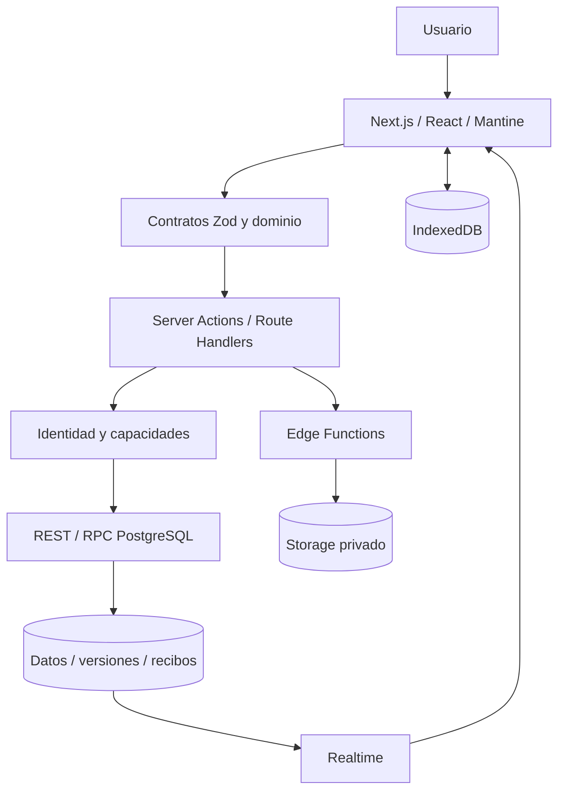
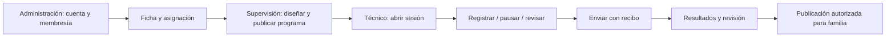
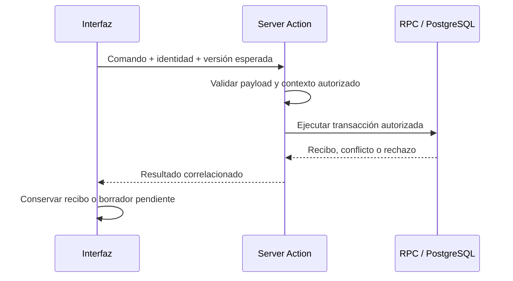

# Arquitectura y flujos

## Componentes

Frontend y backend web forman una aplicación Next.js. PostgreSQL 17 es la única dependencia de datos: aloja el esquema, las funciones SQL y las políticas RLS. La aplicación implementa sesiones, invitaciones, recuperación de contraseña y almacenamiento privado de archivos. La autorización efectiva se aplica en servidor y base de datos; esconder un botón no concede ni revoca permisos. Los cambios entre usuarios se descubren por sondeo periódico, que siempre provoca una lectura autorizada.

| Ubicación | Responsabilidad |
|---|---|
| `app/` | Rutas, páginas, layouts y handlers HTTP |
| `src/views/`, `src/features/` | Pantallas y funcionalidades |
| `src/domain/` | Contratos, validaciones, estados y reglas |
| `src/modules/` | Adaptadores, Server Actions y paneles funcionales |
| `src/lib/db/` | Pool, cliente de consultas por rol y tipos de base de datos |
| `src/lib/auth/` | Sesiones, contraseñas, tokens de un solo uso y correo |
| `src/lib/storage/` | Objetos privados en volumen (adjuntos y avatares) |
| `db/bootstrap.sql` | Roles, esquema `auth`, shim de Storage y publicación |
| `db/migrations/` | Esquema, funciones SQL, RLS y grants |
| `infra/` | Construcción y operación del servicio web |

Las migraciones son la fuente del esquema y de sus permisos. Los tipos generados facilitan el consumo desde TypeScript; no reemplazan las restricciones SQL. Los módulos históricos que siguen teniendo consumidores forman parte de la compatibilidad y no deben eliminarse únicamente por su nombre.

## Identidad y perfiles

`src/features/team/identity.server.ts` obtiene el usuario autenticado y su contexto mediante `aba_identity_context`. La clínica seleccionada debe pertenecer a los contextos autorizados del usuario. La cookie `aba-clinic` selecciona contexto; no otorga permisos.

| Perfil | Alcance |
|---|---|
| Administrador (`admin`) | Equipo y gestión de su clínica, con membresía activa |
| Supervisor (`supervisor`) | Trabajo clínico y programas según asignación y capacidades |
| Técnico (`therapist`) | Sesiones, capturas y lecturas de fichas autorizadas |
| Externo (`external`) | Concesión explícita sobre recursos, con alcance y vigencia |
| Familiar (`family`) | Contenido publicado para sus vínculos autorizados |

El nombre, profesión y avatar son datos de presentación, no roles de seguridad. La autorización combina membresía, asignación, recurso y vigencia; consultar `src/lib/authorization/student.ts` y las funciones SQL correspondientes. La invitación pendiente no equivale a acceso concedido. El familiar no recibe acceso general a la ficha.

## Datos clínicos

El modelo agrupa clínicas y membresías; fichas y antecedentes; asignaciones; programas y versiones; sesiones y registros; colaboración; publicaciones familiares; agenda; archivos y recibos. Las relaciones concretas están en las migraciones y en `src/lib/db/database.types.ts`.

Los programas publicados conservan versiones. Las sesiones y capturas referencian su contexto de programa y mantienen estados explícitos. Las cinco dimensiones de medición son porcentaje, frecuencia, intervalo, duración y latencia. Los cálculos y exportaciones deben respetar la semántica de cada dimensión, sus pausas y sus ventanas de observación.

Los datos V1 conservan compatibilidad con los contratos V2. Un agregado histórico no permite reconstruir eventos que nunca fueron almacenados. El archivado lógico y la eliminación física son operaciones diferentes.

## Flujo clínico

La colaboración externa es una concesión independiente, limitada por recurso. Agenda y participantes organizan el trabajo; no sustituyen la asignación clínica ni las comprobaciones de acceso.

## Escrituras y concurrencia

Los comandos V2 correlacionan operación, clave de idempotencia y recurso. Un ACK contiene el recibo y la versión confirmada. Ante un timeout, reintentar el mismo comando, con el mismo payload e identidad. Un conflicto de versión requiere revisión; un rechazo de permisos requiere resolver el acceso. Un fallo al refrescar la pantalla no invalida una escritura ya confirmada. Algunos contratos históricos usan resultados propios: comprobar el contrato concreto antes de integrar.

## Offline y archivos

IndexedDB retiene la selección descargada y la cola de sesiones/capturas, separadas por usuario y clínica. El modo offline no cubre toda la administración ni el diseño de programas. Las dependencias deben confirmarse antes de enviar operaciones dependientes. Si falla la persistencia local del ACK, el reintento conserva el comando exacto para recuperar su recibo sin duplicar la escritura. Los conflictos y las revocaciones bloquean la operación y conservan el trabajo pendiente.

Los adjuntos siguen un flujo de reserva, carga, verificación y confirmación. Storage es privado; las lecturas requieren autorización actual. MIME, tamaño e integridad se validan según el propósito. Archivar un archivo no implica borrar sus bytes. Una limpieza física requiere alcance explícito, comprobación de referencias y respaldo.

## Límites operativos

`/api/health` comprueba la disponibilidad del servidor web; no certifica por sí solo Auth, base de datos o Storage. La construcción Docker tampoco acredita una publicación ni aceptación funcional. Chat y adjuntos de chat quedan fuera de la entrega actual. Los recorridos humanos finales y la preparación de producción se validan por separado de CI.
